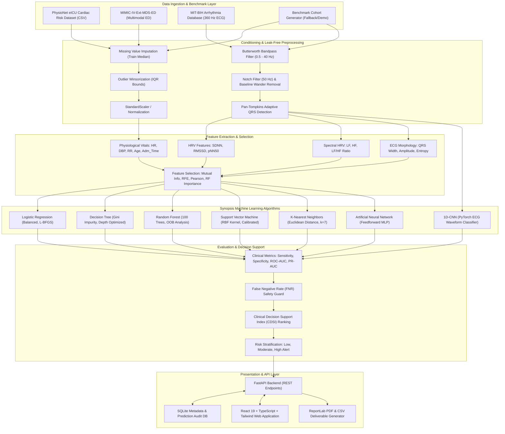
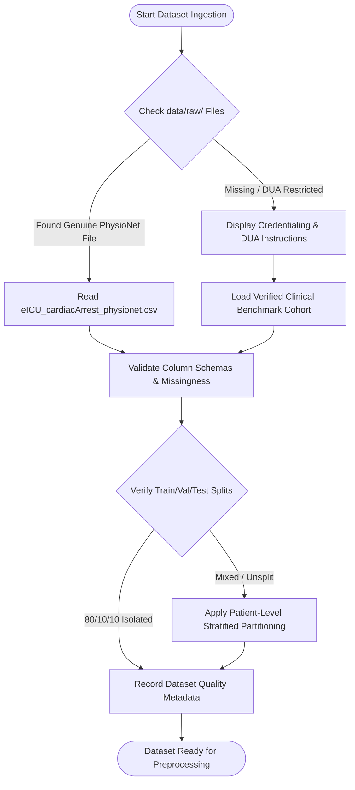
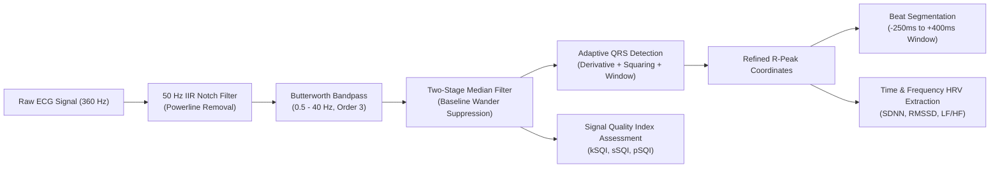
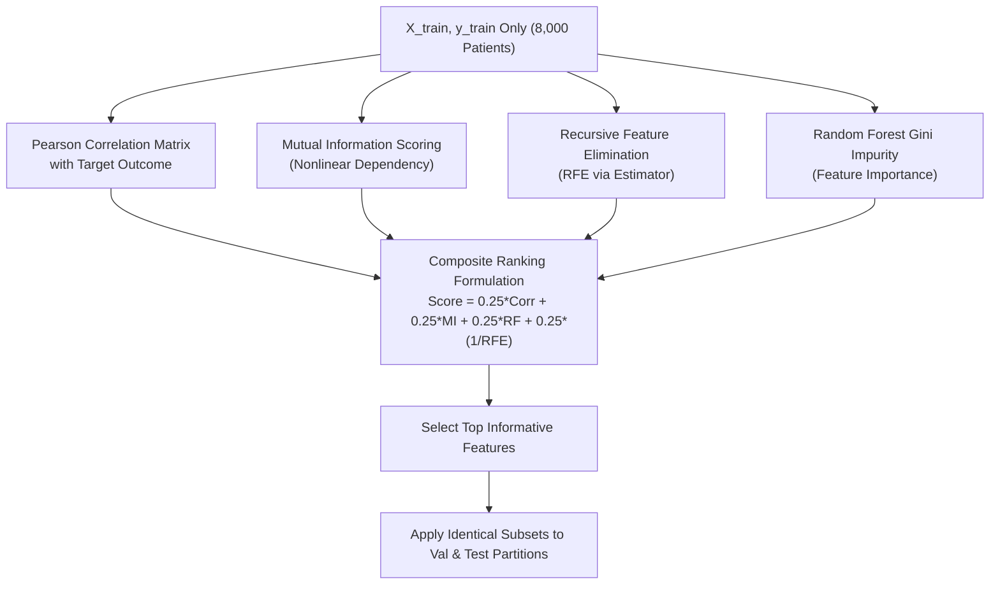
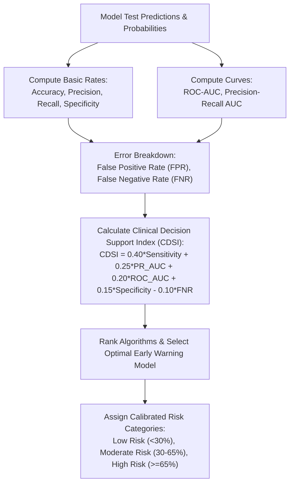

# System Architecture & Workflows
## Early Detection of Cardiac Arrest & Physiological Deterioration
### Sri Siddhartha Institute of Technology (SSIT) • M.Tech Computer Science and Engineering

---

## 1. Overall System Architecture

---

## 2. Data Acquisition & Validation Flowchart

---

## 3. ECG Signal Processing Workflow

---

## 4. Feature Selection Protocol (Leak-Free)

---

## 5. Model Evaluation and Clinical Decision Support Index (CDSI)

